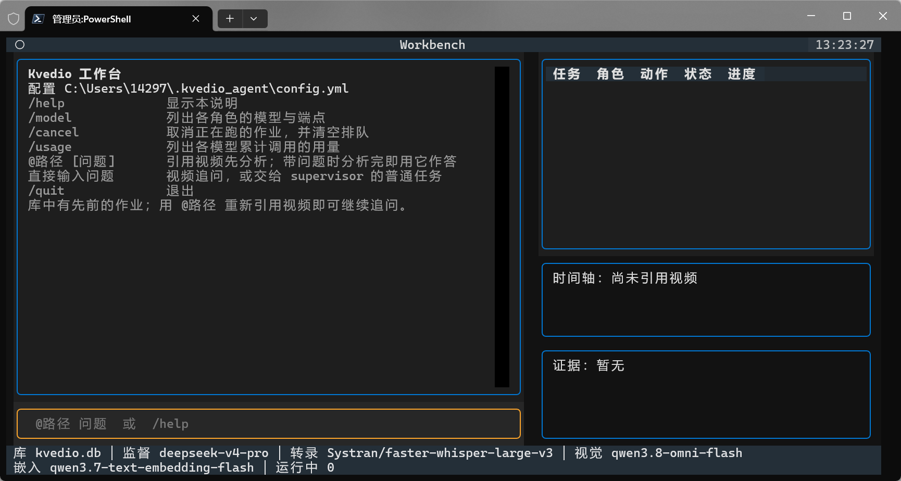
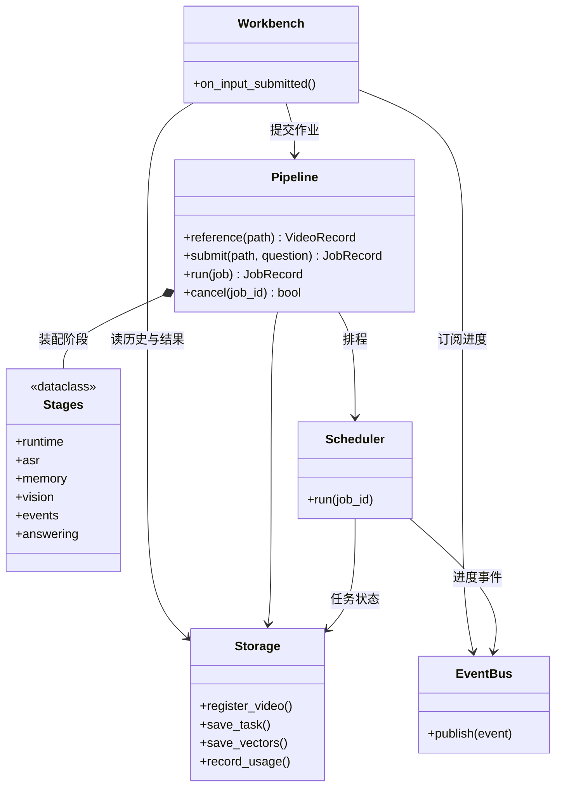
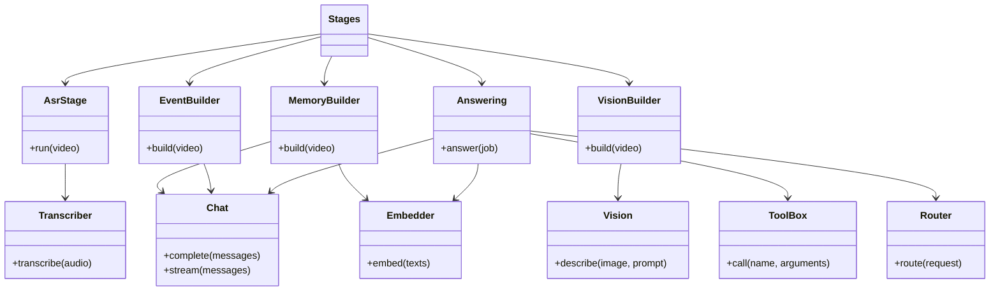
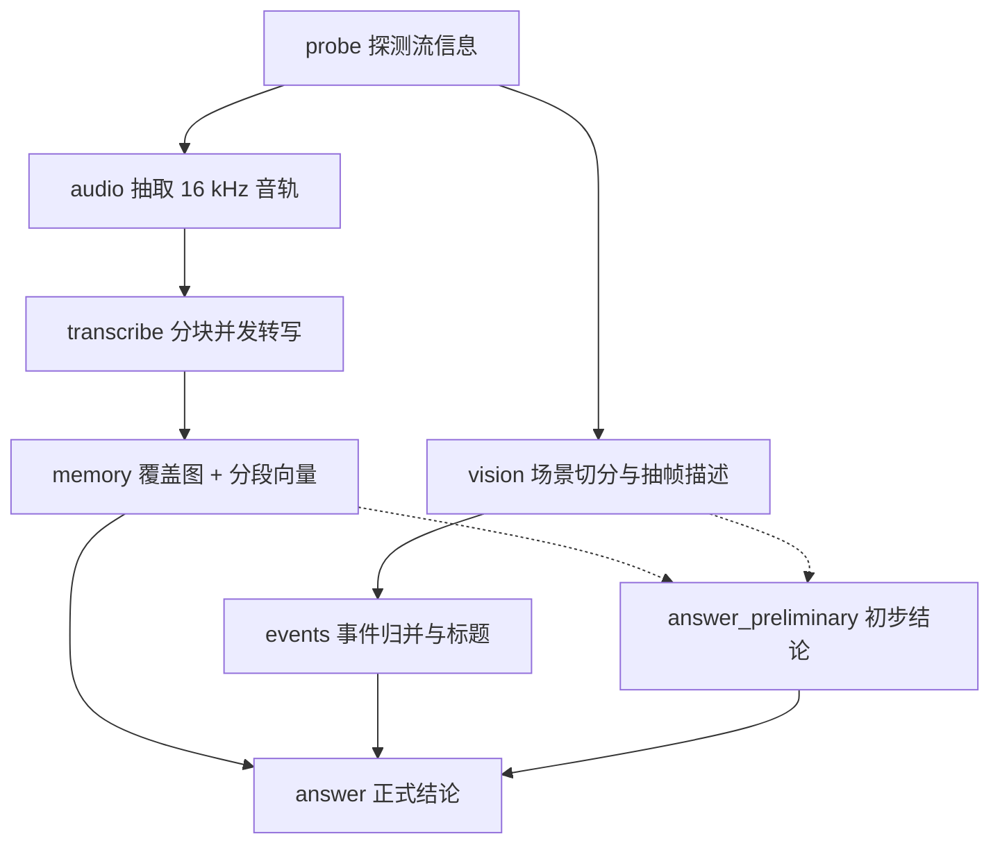

# kvedio-agent1

本地长视频理解 agent，界面是终端。用户 `@` 引用磁盘上的视频，系统先把视频分析成可检索的产物，再回答追问的那句话——同一段视频问多少遍都不必重跑分析。分析拆成可追踪的任务图，结论的每一条都指向录像中的具体时刻。

`Python 3.13` · `Textual` · `SQLite` · `PyAV` · `faster-whisper` · `MIT`

它做五件事：

- **定位内容**：给定时刻或区间，报出那里说了什么——覆盖该区间的转写原文。
- **转写**：整段录音转成带毫秒时间戳的分段文本，后续所有环节都读它。
- **分析**：汇总并回答问题，结论带时间戳证据，同时给出执行计划、分阶段轨迹与质量判定。
- **作业管理**：工作台列出引用过的视频与作业，运行中可看进度，做完的结果留在屏幕上继续追问。
- **入库**：视频按路径引用而非复制，身份是文件内容指纹；同名替换或截断的文件是新视频，不会复用旧产物。

## 界面示例



四区一栏，所有内容都来自同一次运行：

| 区域 | 内容 |
| --- | --- |
| 对话 | 计划与检索轨迹、流式写出的结论；结论里每个 `[分:秒]` 都能在证据区找到对应原文 |
| 任务 | 任务图节点：角色、动作、状态、进度；失败节点保留错误原因 |
| 时间轴 | 场景与事件，画面描述与同期声并排，引用可以落在只有画面的时刻 |
| 证据 | 被引用的转写原文与场景帧 |
| 状态栏 | 数据库文件、四个角色实际绑定的模型、运行中任务数 |

工作台内可直接输入的指令：

| 输入 | 作用 |
| --- | --- |
| `@videos/weekly.mp4 这场会议讨论了什么` | 引用并分析，分析完用这句话作答；路径含空格时加引号 |
| `@videos/weekly.mp4` | 只引用并分析，之后再单独提问 |
| `这场会议定了哪些事` | 直接输入问题，就是对当前视频的追问 |
| `/model` | 列出各角色的模型与完整端点 |
| `/cancel` | 取消当前作业，清空排队 |
| `/usage` | 各模型的累计调用量 |
| `/help` | 语法说明 |
| `/quit` | 退出 |

## 环境要求

### 基础环境

| 项目 | 要求 | 说明 |
| --- | --- | --- |
| Python | 3.13+ | `.python-version` 固定为 3.13 |
| 包管理 | [uv](https://docs.astral.sh/uv/) | 负责同步依赖与运行入口 |
| 容器 | Docker Engine / Docker Desktop | 仅本地跑转写服务时需要 |
| ffmpeg | 不需要单独安装 | 解码器随 `av` 一起安装 |

### 运行 faster-whisper-large-v3 的主机建议

默认的转写服务是 Docker 里的 `speaches`，模型为 `Systran/faster-whisper-large-v3`（int8 量化，常驻显存）。

| 项目 | 最低 | 建议 | 参考实测量级 |
| --- | --- | --- | --- |
| GPU | NVIDIA，显存 4 GB，驱动支持 CUDA 12 | NVIDIA 8 GB 及以上 | RTX 4060 Laptop 8 GB，`int8_float16` |
| 显存占用 | large-v3 量化后约 2 GB | 8 GB 可同时留出解码与系统占用 | 模型常驻不卸载 |
| CPU | 4 核 | 8 核 | 用于音频解码与分块 |
| 内存 | 16 GB | 32 GB | 与服务同机运行时按上限准备 |
| 磁盘 | 5 GB | 20 GB 以上 | 权重约 3 GB，缓存在命名的 Docker 卷里 |
| 吞吐 | — | — | RTF ≈ 0.29：1 分钟音频约 17 秒转完，1 小时录像约 17 分钟 |

RTF 是「处理耗时 / 音频时长」，只统计 GPU 侧转写，不含抽取音轨与后续模型调用。`asr_concurrency` 大于 1 会成倍抬高显存与 GPU 占用，8 GB 卡建议保持 `1`，16 GB 以上再考虑 `2`。

没有 GPU 也能跑：把 `WHISPER__INFERENCE_DEVICE` 改成 `cpu`、`WHISPER__COMPUTE_TYPE` 改成 `int8`，`deploy.resources` 里的 GPU 预留去掉，速度大约降到 GPU 的几分之一，只适合短录像。

### 不用本地转写服务

**默认配置是本地 Docker 起 faster-whisper，但这不是唯一选择。** 转写角色只是一个 OpenAI 兼容的转写端点，改 `~/.kvedio_agent/config.yml` 里的 `asr` 就能换成任何实现 `POST /audio/transcriptions` 的服务商——云厂商、私有部署、自建网关都行，重启程序生效，不需要改代码：

```yaml
asr:
  model: paraformer-v2                                   # 服务商侧的模型名
  url: https://dashscope.aliyuncs.com/compatible-mode/v1/audio/transcriptions
  api_key: env:DASHSCOPE_API_KEY
```

程序发出的请求固定为 multipart：`file`（`audio/wav`，16 kHz 单声道）、`model`、`response_format=verbose_json`，鉴权走 `Authorization: Bearer <api_key>`。对方只要按 OpenAI 的 `verbose_json` 返回带 `start` / `end` / `text` 的分段即可；不带时间戳的响应会被判为不可引用而失败。按服务商计费时，注意 `runtime.asr_chunk_seconds` 与 `asr_concurrency` 直接决定请求数。

## 快速开始

```bash
git clone git@github.com:voyager314/Kvedio-agent.git
cd Kvedio-agent
uv sync
```

第一步，起本地转写服务（用云服务商转写则跳过）：

```bash
docker compose up -d
docker compose logs -f asr        # 首次会下载约 3 GB 权重
```

把权重预载进显存，避免每个分块前重新加载（模型名必须是完整 HF repo id）：

```bash
KEY=$(docker exec speaches printenv API_KEY)
curl -X POST -H "Authorization: Bearer $KEY" \
  http://127.0.0.1:8000/v1/models/Systran/faster-whisper-large-v3
curl -X POST -H "Authorization: Bearer $KEY" \
  http://127.0.0.1:8000/api/ps/Systran/faster-whisper-large-v3
```

第二步，首次运行会生成配置模板并建库：

```bash
uv run kvedio-agent1 doctor
```

按提示把 `~/.kvedio_agent/config.yml` 里四个角色的 `api_key` 填好（推荐写 `env:变量名`），再核对一遍：

```bash
uv run kvedio-agent1 config
```

第三步，进工作台：

```bash
uv run kvedio-agent1
```

## 命令参考

### 程序命令

| 命令 | 作用 |
| --- | --- |
| `uv run kvedio-agent1` | 打开工作台（默认子命令，等同 `workbench`） |
| `uv run kvedio-agent1 config` | 显示配置位置与四个角色的绑定，不显示密钥 |
| `uv run kvedio-agent1 doctor` | 检查配置、数据库、解码器与各角色是否可用 |

`doctor` 的正常输出形如：

```
[ok] 配置  C:\Users\<user>\.kvedio_agent\config.yml
[ok] 数据库  C:\Users\<user>\.kvedio_agent\kvedio.db
[ok] 解码器  PyAV 19.0.2 / FFmpeg 9.0.2
[ok] 监督  deepseek-chat
[ok] 转录  Systran/faster-whisper-large-v3
```

三处落盘位置，可用环境变量 `KVEDIO_AGENT_HOME` 整体改到别处：

| 路径 | 内容 |
| --- | --- |
| `~/.kvedio_agent/config.yml` | 用户配置，程序只读不覆盖 |
| `~/.kvedio_agent/kvedio.db` | SQLite：视频、作业、任务、转写、向量、答案、用量 |
| `~/.kvedio_agent/workspace/` | 产物目录：抽取的音轨、抽取的帧 |

### Docker 命令

| 命令 | 作用 |
| --- | --- |
| `docker compose up -d` | 后台启动转写服务 |
| `docker compose logs -f asr` | 跟日志；首次启动可看权重下载进度 |
| `docker compose ps` | 查看健康状态（healthcheck 每 30 秒一次） |
| `docker compose restart asr` | 改过环境变量后重载 |
| `docker compose down` | 停止并删除容器，权重卷保留 |
| `docker compose down -v` | 连权重卷一起删；下次要重新下载 3 GB |
| `API_KEY=<口令> docker compose up -d` | 覆盖共享口令，需与 `config.yml` 的 `asr.api_key` 一致 |
| `HF_ENDPOINT=<镜像站> docker compose up -d` | 换权重下载源；镜像站若对 `/resolve/` 返回 308 且缺 `X-Linked-ETag`，下载会失败，此时回退官方源 |

### docker-compose 参数说明

| 参数 | 默认值 | 作用 |
| --- | --- | --- |
| `image` | 固定 digest 的 `ghcr.io/speaches-ai/speaches` | 用 digest 而非 `latest-*` 标签，避免一次快照换掉配置字段 |
| `container_name` | `speaches` | 便于 `docker exec` 取口令 |
| `restart` | `unless-stopped` | 开机或崩溃后自动起 |
| `ports` | `127.0.0.1:8000:8000` | 只绑回环；接口只有一个共享口令，不面向局域网 |
| `volumes` | `hf-hub-cache:/home/ubuntu/.cache/huggingface/hub` | 权重缓存卷，名固定，去掉项目名前缀才不会被另建空卷 |
| `API_KEY` | `local` | 转写接口共享口令，必须与 `asr.api_key` 相同；留空等于接口公开 |
| `WHISPER__INFERENCE_DEVICE` | `cuda` | 推理设备；无 GPU 改 `cpu` |
| `WHISPER__COMPUTE_TYPE` | `int8_float16` | 量化方式；显存吃紧用 `int8`，精度敏感用 `float16` |
| `WHISPER__TTL` | `-1` | 模型闲置卸载秒数；`-1` 常驻显存，避免每个分块前重载 |
| `ENABLE_UI` | `false` | 关掉镜像自带的 Web 界面，只留 API |
| `HF_ENDPOINT` | `https://huggingface.co` | 权重下载源 |
| `healthcheck` | `python -c urllib...` 每 30 s | 健康检查自身也过鉴权，口令从容器环境变量读，不进命令行 |
| `deploy.resources.reservations.devices` | 1 张 NVIDIA GPU | GPU 透传；没有 NVIDIA Container Toolkit 时此行会失败 |
| `volumes.hf-hub-cache.name` | `hf-hub-cache` | 显式命名卷，与 `volumes` 段呼应 |

## 配置说明

`~/.kvedio_agent/config.yml` 只在启动时读一次，改完重启程序生效。四个角色各绑一个模型：

| 角色 | 承担的工作 | 协议 |
| --- | --- | --- |
| `supervisor` | 意图路由、检索计划、写结论、校验引用、自由问答 | `POST /chat/completions` |
| `asr` | 分块转写 | `POST /audio/transcriptions`（`verbose_json`） |
| `video` | 场景抽帧描述、事件归并 | `POST /chat/completions`（多模态） |
| `embedding` | 分段向量，供混合召回 | `POST /embeddings` |

`url` 是**完整请求地址**，程序原样 POST：不在其后拼接路径，也不改写末尾斜杠。写成裸主机或只写到 `/v1` 时，第一次调用就会 404。

`api_key` 支持两种写法：`env:DASHSCOPE_API_KEY` 引用环境变量（推荐，密钥留在文件之外），或直接写明文（注意文件权限，POSIX 下首次生成时是 `0600`）。密钥不会出现在日志、错误信息、面板和 `config` 输出里。

`runtime` 段与具体模型无关，是本机的资源上限：

| 字段 | 默认 | 作用 |
| --- | --- | --- |
| `max_video_duration_seconds` | `7200` | 接受的最长源视频时长，超出的直接拒绝 |
| `retention_days` | `30` | 作业产物保留天数；源视频从不删除 |
| `max_global_workers` | `6` | 同时运行的任务数上限 |
| `request_timeout_seconds` | `600` | 单次上游调用超时；本地转写一块 300 s 音频约需 90 s，默认值不宜调小 |
| `stage_budget_floor_seconds` | `300` | 单个阶段预算下限，预算按媒体时长推导，不足时取此值 |
| `stage_budget_scale` | `1.0` | 预算整体倍数；机器慢调大，想更早发现停滞调小 |
| `stage_budget_ceiling_seconds` | `0` | 所有阶段预算的硬上限，`0` 表示不设 |
| `asr_chunk_seconds` | `300` | 单次转写请求承载的音频长度 |
| `asr_concurrency` | `1` | 同时发出的转写请求数 |
| `coverage_block_seconds` | `180` | 覆盖图每块代表的时长 |
| `scene_max_seconds` | `90` | 固定机位没有剪辑点，超过这个时长的镜头等分后再描述 |
| `workspace_dir` | `null` | 产物目录；`null` 表示 `~/.kvedio_agent/workspace` |

## 项目架构

### 组件与依赖

`interface` 只负责呈现与输入解析，`core` 是引擎且不反向依赖界面；所有出网调用收敛在 `core/llm` 的四个适配器里。  
编排与基础层：



阶段与它们背后的适配器：阶段持有业务规则与缓存键，适配器只认一个端点。



要点：

- `Pipeline` 持有唯一的 `Scheduler` 与 `Storage`，负责「这条引用走到哪一步」，不关心终端怎么显示。
- `Scheduler` 按依赖与状态机推进任务，进度经 `EventBus` 单向流向界面；取消与超时在调度层统一处理。
- 每个阶段自己声明缓存键与重试策略；已完成的产物按键命中即跳过，因此重开一次分析不会重复付费。
- 四个 `llm` 适配器只做一件事：把一次调用发到配置里的完整地址，并把错误转成统一的 `ModelError`。

### 任务图

一次「引用 + 提问」展开成固定的有向图。两条分支都从探测出发，互不消费对方产物；最后的作答按 `PARTIAL` 依赖合流，一条分支失败只损失它的证据，不否决结论。



实线是「全部完成才继续」，虚线是「任一完成即触发」：初步结论只等两路里先到的那一路，正式结论要等两路都到。只引用不提问时图在两条分支后结束；两路证据都已在库里时也不排初步结论——它存在的意义只是让用户先看到一部分结果。

### 数据与产物

SQLite 单文件（`~/.kvedio_agent/kvedio.db`）承载全部状态：`video`、`job`、`task`、`transcript`、`transcript_segment`、`checkpoint`、`answer`、`answer_citation`、`coverage_block`、`segment_vector`、`scene`、`event`、`usage`。音轨与帧放在 `workspace/` 下，库里只存路径与缓存键。

## 技术栈

| 层面 | 选型 | 用途 |
| --- | --- | --- |
| 语言 | Python 3.13 | `StrEnum`、类型参数等新语法直接用 |
| 终端界面 | Textual 8 + Rich | 四区布局、`DataTable` 任务表、流式写入 |
| 数据校验 | Pydantic 2 | 配置 schema，未知字段与越界值在加载期拒绝 |
| 存储 | SQLite（标准库 `sqlite3`） | 单文件、无服务、事务足够 |
| 媒体 | PyAV 19（内置 FFmpeg 9） | 探测流、抽音轨、抽帧，无需系统 ffmpeg |
| 出网 | httpx | 四类模型调用共用一套超时与重试 |
| 提示词 | Jinja2 | `prompts/*.j2`，回答语言随提问 |
| 数值 | NumPy | 向量归一化与余弦相似度 |
| 图像 | Pillow | 抽帧缩放、证据帧渲染 |
| 转写服务 | Docker + speaches + faster-whisper（CTranslate2） | 本地 large-v3，OpenAI 兼容接口 |
| 配置 | PyYAML + `env:` 引用 | 密钥留在配置文件之外 |
| 工程 | uv（`uv_build`）、pytest、ruff | 依赖同步、用例、lint 与格式化 |

## 目录结构

```
Kvedio-agent/
├── src/kvedio_agent1/
│   ├── core/                 引擎，不导入界面
│   │   ├── domain/           领域值：视频、作业、任务、转写、场景、事件、答案、用量
│   │   ├── config/           配置发现、模板生成、schema 校验、env 引用解析
│   │   ├── storage/          SQLite schema 与仓储
│   │   ├── tasks/            调度器、状态机、事件总线、预算、取消与超时
│   │   ├── media/            指纹、探测、音轨抽取、场景切分
│   │   ├── llm/              对话/视觉/嵌入/转写四个适配器，统一重试与错误
│   │   ├── asr/              分块策略与转写阶段
│   │   ├── memory/           覆盖图、分段向量、混合召回
│   │   ├── vision/           场景描述与事件归并
│   │   ├── supervisor/       意图路由、检索计划、作答、引用校验、自由问答
│   │   ├── pipeline/         任务图构建与阶段装配
│   │   └── workspace/        产物目录布局
│   ├── interface/            终端界面：CLI 入口、输入语法、TUI 面板与事件泵
│   ├── tools/                监督者可调用的工具：转录概览、关键词检索、按区间取段
│   ├── prompts/              计划、作答、路由、场景、事件等提示词模板
│   └── default/              首次运行写出的配置模板
├── tests/                    单元与集成用例（pytest）
├── docs/
│   ├── assets/               README 截图
│   └── design/               设计文档：模块职责、数据模型、状态机、并发与上下文策略
├── docker-compose.yml        本地转写服务
├── pyproject.toml            依赖、入口、ruff 与 pytest 配置
└── AGENTS.md                 仓库规则：源码分层、注释与类型约定
```

## 开发

```bash
uv sync                      # 含 dev 依赖组
uv run pytest                # 全部用例
uv run ruff check .
uv run ruff format .
```

`AGENTS.md` 是仓库规则的唯一副本：新增包要先改它的包表，注释只写代码无法自述的意图，类型承载结构，定义必须被使用。

## License

MIT，见 [LICENSE](LICENSE)。
